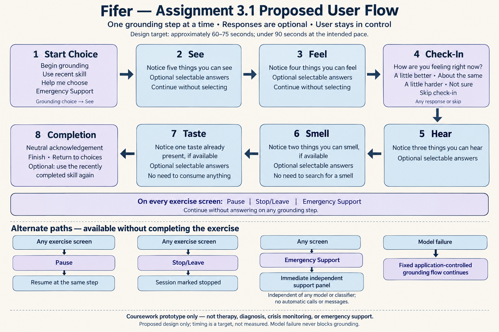

# Fifer — Assignment 3.1 flow diagram evidence



- **Created:** October 15, 2026.
- **Artifact:** `fifer-assignment-3-1-flow.png`, PNG, 1536 × 1024 pixels (landscape).
- **Method:** Built-in GPT image generation. The user explicitly requested image generation after being asked which connected Figma account to use. This artifact is not a Figma or Figma Make export and does not constitute evidence of work completed in either tool.
- **Status:** Proposed UX flow for a fictional coursework prototype; no application behavior was implemented or tested.
- **Prompt:** [Exact generation prompt](../../prompts/fifer-assignment-3-1-flow-imagegen.md).

## Checks actually performed

The generated image was visually inspected. It shows Start Choice → See → Feel → Check-In → Hear → Smell → Taste → Completion, reading left to right across the first row and right to left across the second. The check-in appears immediately after Feel. Optional answers, continuing without answering, the smell/taste availability constraints, and neutral completion choices are visible.

The four alternate paths, persistent Pause / Stop/Leave / Emergency Support controls, independent support access, and the safety note are visible. Timing is explicitly identified as an unmeasured design target. No real crisis numbers, personal data, clinical claims, credentials, or implementation code appear in the image.

After copying the file into this repository, its PNG signature and 1536 × 1024 dimensions were checked from its binary header. This is a static design inspection, not usability testing or a timing study.

## Markdown report insertion

For the repository-root `report.md`, use:

```markdown

```

This artifact does not replace any separate coursework requirement for an actual Figma or Figma Make mockup.
