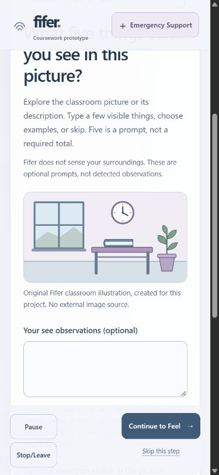

# Fifer — Assignment 3.2

## Repository and submission status

Repository: [nikhilrajk21/Fifer](https://github.com/nikhilrajk21/Fifer). Branch: `master`.

Submitted-version commit: recorded in Git for this reviewed submission. Acceptance tested the working tree before commit. Baseline HEAD `a8edc32df96170bed09cd233cc3a5c2248e0adca` preceded these changes.

The [Part 3.1 report](report-3-1.md) is preserved byte-for-byte. The existing [3.1 milestone](https://github.com/nikhilrajk21/Fifer/commit/615ac73aaa933f8c3ce0004079f0179a133b35b1), [research](docs/research.md) and [flow diagram](docs/mockups/fifer-assignment-3-1-flow.png) remain historical evidence.

The [Part 3.2 submission page](https://psu.instructure.com/courses/2484533/assignments/18506999) requires one report.md following [overview Sections 5–8](https://psu.instructure.com/courses/2484533/pages/assignment-3-overview-mental-health-skills-application). Requirements include a working skill, demonstrated model contribution, SQLite history, measured duration, independent support, failure/leave evidence and a redacted AI evidence log. Core application/storage checks pass and the approved text adapter is now wired behind server-only gates; an actual model response is still unobserved. New relative links resolve locally but need publication with an approved submitted-version commit before upload. See the [requirements checklist](docs/assignment-3-submission-requirements.md).

## Application and research foundation

Fifer is a local Vue/JavaScript → FastAPI/Python → SQLite coursework skills prototype for a fictional student, for example after a group-assignment disagreement. It is not a therapist, diagnostic service or monitored support tool; no clinical effectiveness is claimed. No Expedia Lite files or travel functionality were copied. Only stack separation, persistence concepts and verification practices were reused conceptually.

The supplied course material is the primary research source. R1 informs short pacing; R2/D4 independent persistent Support; R3 explicit Resume and immediate Stop; R4 optional input; D1/D2 atomic screens without distress detection; D3 low-effort responses; D5 optional completed-skill suggestions; D6 dusty blue/lavender and nonjudgmental wording. The complete [R1–R4/D1–D6 mapping](docs/research.md) is preserved. Choice reduces coercion but adds decisions; low input reduces effort but limits history depth; calm visuals still need visible safety controls. Research informs design, not clinical benefit.

## Instructor sensory feedback and implemented flow

The owner relayed instructor sensory feedback through the revision request: tie See to an actual picture, offer comfortable tactile observations, use plausible sounds, and allow none/not sure/skip for smell and taste. This attribution comes from the owner's request; no independent instructor evaluation, quotation or mark is claimed. [Selected prompt excerpts](prompts/assignment-3-2-evidence.md) link the request to changes and tests.

The [original bundled classroom SVG](frontend/src/assets/classroom.svg) shows a window, wall clock, blue book, desk and potted plant. All five See examples match those objects; alt text describes them. Fifer explicitly says it does not sense the user's surroundings.

Start choice → See 5 → Feel 4 → optional check-in → Hear 3 → Smell 2 → Taste 1 → completion screen → explicit **Finish activity**. Vue owns the sequence/counts. Each category supports optional text/examples and empty Continue/Skip without quotas or scoring. Feel requires no touching. Hear offers imagined birds, rustling leaves and footsteps. Smell/Taste permit None/Not sure without scent-finding, eating or drinking. The after-Feel check-in includes “A little better” and Skip. See [design](docs/design.md).

The [3.1 diagram](docs/mockups/fifer-assignment-3-1-flow.png) is a proposed flow, not a detailed Figma screen mockup. Detailed Figma/Figma Make artifact: **Not yet available**.

## Safety and user control

Pause preserves place and requires explicit Resume. Stop/Leave exits without confirmation and never marks completion. With FastAPI stopped, browser acceptance opened static Emergency Support from start, step, paused, unsaved/error and completion states. Returning to unfinished grounding opens paused. Support requires no model/classifier, storage response or disclosure.

The displayed user-approved sentence is “Please contact 911 for emergency support.” It is text only, without a phone link or automatic calling/messaging. Instructor approval of that particular wording remains **Not verified**; approval of Gemini substitution does not establish wording approval. Prototype/fictional-use notices remain visible. No diagnosis, medical/treatment advice, distress inference or human-monitoring claim is authorized. Crisis-related text topics select the reviewed safety paragraph, not a risk score or safety assessment. See [safety](docs/safety.md).

## SQLite history and personalization

SQLite stores fictional session ID, skill, start/end/update times, active/paused/stopped/completed status, resume step, optional check-in, revisions and separate setup/active/pause/support durations. Only acknowledged explicit Finish contributes to the optional recent-skill suggestion. Refresh restored Feel paused; Stop persisted stopped; deleting the completed session removed its suggestion.

Fictional text-message saving is opt-in and OFF by default, separately from context sharing. Session/chat metadata and opted-in messages remain until Delete/Clear; opting out keeps old messages. Delete removes linked messages. Clear removes session/message/check-in/duration/recent history and resets saving OFF. Acceptance observed zero saved messages with OFF, two with ON, retention after opt-out and zero history records after Clear.

Sensory text stays in tab memory and is excluded from save payloads and chat context. Its acceptance marker was absent from SQLite before Clear. No voice audio/transcripts are persisted. Additive initialization, parameterized SQL and temporary test databases preserve normal history. Failed writes show Unsaved changes; retry recovered queued completion. The normal database, backend/data/fifer.sqlite3, is excluded from Git.

Daily quota tables retain only browser UUID hash, UTC day and attempt/start count. Today's counters survive Delete/Clear; older buckets are removed on a later request for that feature. This operational exception is disclosed. Clearing browser data can reset effective identity: it is not verified per-person enforcement.

## Approved text contribution

Chat stays outside grounding. Its approved target is `gemini-2.5-flash`, using reviewed Fifer app/skill/safety content only. Normal runtime is a **deterministic local mock**, not live model output. The HTTPX adapter is wired through FastAPI and mode-aware Chat UI; it requires both `FIFER_TEXT_PROVIDER=gemini` and `FIFER_TEXT_LIVE_AUTHORIZED=true` in the backend process, and partial settings fail closed. A key or browser action alone cannot enable it. No arbitrary files, web pages, private records or invented history are retrieved.

Sharing starts OFF; explicit sharing supplies only actual completed-session count, latest completed skill and its optional check-in. No profile or previous messages are supplied. Missing key, provider error, invalid output, timeout and late-result handling passed mocked checks. Limits: 300 proposed output tokens, 5 attempts/chat session, 20/anonymous browser/UTC day, 15 seconds and no retries. The mock selects one short reviewed paragraph. See [text evidence](docs/text-chat.md).

The attempted live Gemini text test did not work in PowerShell; no successful real model response was observed. Live access, generated behavior, usage and costs are **Not verified**. Mocks alone do not demonstrate the assignment's actual model contribution.

## Gemini Live substitution and lifecycle

The owner reports instructor approval of Gemini Live substitution. Target: `gemini-3.8-live`, separate from text Chat. The implemented path is browser Web Audio/PCM ↔ FastAPI WebSocket ↔ **in-process mock**. The real Gemini Developer API WSS connector remains unimplemented/disabled; mock voice never reads the key. API/AI Studio is the configured family, not Vertex.

Unlike the described OpenAI demo, this uses no SDP, RTCPeerConnection or oai-events endpoint. One Live model is the proposed audio-to-audio contribution; text Chat is not a second-model voice pipeline. Course Section 5 makes speech optional; identical demo mechanics or assessed equivalence are not claimed.

FastAPI owns [Live instructions](backend/live_voice.py): warm, brief, nonjudgmental, one focused question, reviewed context only; no medical advice, invented records, tools, second model or grounding/Support control. PCM is mono signed 16-bit little-endian: 16 kHz input, 24 kHz output. Mock output is a labelled synthetic tone, not speech understanding.

Start requests audio-only permission; active status waits for confirmed mock setup. Mute stops capture/forwarding and sends manual-VAD activityEnd while preserving the session/playback. Unmute starts the next turn after response completion. End releases tracks, worklet, playback buffers/sources, AudioContext, timers and socket; FastAPI cancels setup and closes the mock upstream. Duplicate Starts/Ends and stale results are guarded. Interruption ends the session; seamless nonterminal barge-in is unfinished. Cleanup/maxima are mock-tested; abrupt termination remains best-effort.

Voice bounds: 300 wall-clock seconds, five turns, 20 seconds/input turn, 15 seconds/response audio, 10-second setup/15-second response deadlines, no retries/reconnect, two accepted starts/browser/UTC day and one concurrent session/browser in the single-worker prototype. Setup failures after reservation count. These are not dollar caps: actual Google billing/account controls and separate test/cost authorization are prerequisites to any real call. See [voice evidence](docs/voice.md).

## Timing

The completed fictional automated browser run stored **31.021 s active**, **32.528 s setup**, **5.941 s paused** and **0.109 s Support**. Active time starts at the first exercise screen and includes navigation/application delays through Finish; setup, pauses and Support are separate. This fast run was below 90 seconds, not a student usability study or proof of comfortable 60–75-second pacing. Never force completion or auto-advance at a deadline.

## Verification and evidence

[Acceptance matrix](docs/verification/part-3-2-acceptance.md): actions, expected/observed outcomes, commands and limits. Browser testing used an isolated ignored database, not normal history; SQLite inspection used read-only mode. **No explicitly authorized paid/live observation exists.**

| Check | Actual result |
| --- | --- |
| Backend unittest suite, temporary SQLite and mock providers | Current: 62/62 passed; corrected setup-disconnect case also passed 25 consecutive focused reruns |
| Frontend Node suite, grounding/voice mocks | 49 passed |
| Vite build; pip check; npm ls; git diff --check | Passed |
| Browser fixed flow, optional input, Pause/Stop, backend-off Support and save recovery | Passed in exercised scenarios |
| Browser/SQLite refresh, consent, history/Delete/Clear and recent skill | Passed |
| Voice denial/synthetic capture/Mute/End; interruption, late/failure/timeout cases | Mock evidence passed; Gemini Live voice remains mock-only and real provider behavior is Not verified |
| Keyboard and 390×844 responsive smoke check | Passed; full accessibility/physical phone Not verified |
| Credential-pattern scan and sensory sentinel | No matches across 56 inspected source/build files; no sentinel in test DB before Clear |
| Dedicated lint, browser E2E and accessibility scripts | Not verified: no scripts found |

This actual screenshot was copied unchanged from acceptance evidence and shows fictional UI only. Existing [initial UI](docs/part-3-2.md) and [storage evidence](docs/part-3-2-storage.md) describe earlier checkpoints, not the latest scene/voice state. No screenshot or recording was invented. Recordings: **Not yet available**.

Revised teardown evidence: `test_disconnect_during_setup_closes_wire_and_allows_fresh_session` previously raised `concurrent.futures.CancelledError` while leaving the Starlette TestClient WebSocket context. The abrupt-disconnect portion now drives the ASGI endpoint directly and verifies mock-upstream close plus reservation release; a separate fresh TestClient session verifies restart. The full suite passed 62/62, followed by 25/25 focused passes. The Starlette TestClient/httpx deprecation warning remains; no unapproved `httpx2` dependency was added. This does not verify real Gemini Live teardown.

## AI use and revised approach

[AI-USE.md](AI-USE.md) records Codex's code/documentation/test roles, target model IDs, the GPT-generated 3.1 diagram and planned Figma work. Exact Codex model/effort and image-model version are not verified. [Curated redacted prompts/change/test/decision log](prompts/assignment-3-2-evidence.md) records sensory revision, bounded text/voice authorization and acceptance.

Revised approach: setup originally awaited provider acknowledgement before reading End/disconnect. Inspection identified delayed cleanup risk; setup now races local shutdown and is canceled/closed. A later TestClient context-exit cancellation made the full suite inconsistent, so the teardown test was split into a direct-ASGI abrupt-disconnect assertion plus a separate fresh-session assertion; current repeated mock evidence is green, and no live call is claimed. An actual read-only SQLite command failed from shell quoting and succeeded via stdin without altering data. Generic sensory choices were replaced by examples matching the actual picture. No credentials, private conversations or research-participant material are included.

## Unfinished items and submission review

The skill, persistence, independent Support, and mock-tested text/voice paths work in the exercised scope. The text adapter is wired behind explicit backend gates, but the attempted PowerShell live Gemini text test did not produce a response; no successful real model response was observed. Gemini Live voice remains mock-only. Full Part 3.2 acceptance is **incomplete** because an actual model contribution has not been demonstrated. No morning change is promised as submitted functionality.

Also unresolved: submitted-version commit and publication of new evidence links; instructor confirmation of support wording; detailed Figma/Figma Make screens; hardware microphone/provider cleanup, full-duration voice, accessibility/contrast/screen-reader, physical-phone/cross-browser and clean-checkout verification. The credential scan is limited, not a full historical/forensic audit. Passing mocks do not prove clinical benefit or live-model safety.

Part 3.3 requires at least fifteen fictional scenarios, three explicit behavior checks, a small relevant live selection, and demonstration/process-recording evidence. These are future work. The current submission limitation is the absent successful real model observation and unfinished detailed Figma/hardware/accessibility evidence. Run/recreation commands: [README.md](README.md).
